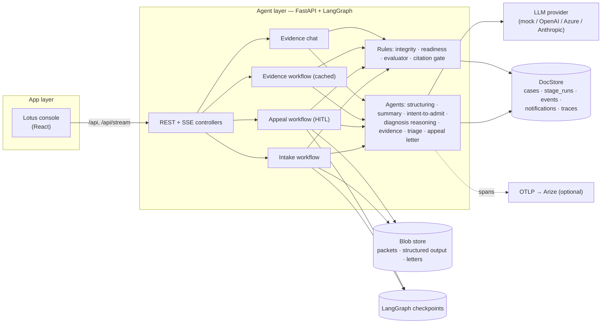
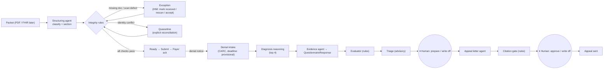
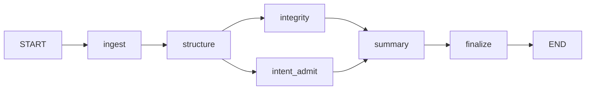
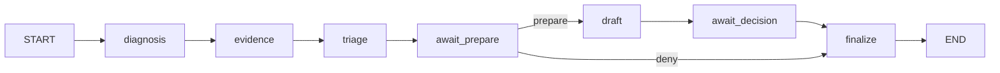

# Lotus AI Health — Architecture

## 1. Layers

## 2. Process flow

## 3. Workflows

### Intake (`workflows/intake.py`, thread `intake:<case>`)

| Node | Kind | Idempotency key | Output |
|---|---|---|---|
| ingest | tool | page checksums | manifest in blob, audit, events |
| structure | LLM ×documents (parallel) | page checksums | `classified_type`, canonical `sections` |
| integrity | rules | (recomputed; pure) | findings, blockers, status |
| intent_admit | LLM | page checksums | `admit_datetime` + quote |
| summary | LLM | checksums + admit time | summary JSON (≈1/10 size) |
| finalize | rules | (status, blockers) announcement key | Ready / Exceptions event + email |

### Appeal (`workflows/appeal.py`, thread `appeal:<case>:<notice date>`)

`await_prepare` and `await_decision` call `interrupt()`. The API checks which step a thread waits on
(`pending_step`) before resuming, so a stale button cannot skip a step. Approve is refused unless the citation
gate passed; write-off requires a rationale.

### Evidence workflow (`evidence_for`)

Fan-out per leaf question × per document (parallel, bounded by the LLM semaphore), rank by confidence and
document priority, drop below `evidence_confidence_threshold`, keep top 3. Cache key:
`case + questionnaire + record checksums + denial notice date`. The evaluator always re-runs (it is cheap
and pure), so criteria changes take effect without re-querying the model.

## 4. Data model

* **Case** — identifiers, payer + policy, documents → pages (text, OCR confidence, skew, checksum),
  findings, blockers, summary, admit time, denial, appeal, submission, audit log, correlation id.
* **Questionnaire / QuestionnaireResponse** (FHIR-lite) — groups carry `operator`, `n`, `arithmetic`,
  `points`; leaves carry retrieval `keywords`; answers carry `evidence[]` (doc, page, section, quote,
  confidence).
* **AppealLetter** — opening, closing, assertions (`text`, `citation`, `verified`), gate result.

Collections: `cases`, `stage_runs`, `events`, `notifications`, `traces`, `announcements`, `settings`.

## 5. Safety properties (tested)

| Property | Where | Test |
|---|---|---|
| Readiness is rule-based; any open blocker keeps a packet out of Ready | `agents/integrity.py` | `test_integrity_outcomes` |
| Critical scan defects can't be accepted; identity needs an explicit choice + rationale | `ops.py` | `test_human_resolution_paths` |
| Re-running a workflow repeats no LLM calls and emits no duplicate events | ledger | `test_intake_is_idempotent` |
| Paused appeals resume after restart without repeating work | checkpointer + ledger | `test_appeal_survives_restart` |
| Fabricated or missing citations are flagged; approval blocked | `citation_gate` + API | `test_citation_gate_rejects_fabricated_quote`, `test_console_api` |
| Chat rejects injection and off-topic questions; answers carry verified citations | `agents/chat.py` | `test_chat_guardrails` |
| Evaluator operator semantics | `agents/evidence.py` | `test_evaluator.py` |

## 6. Open decisions

1. **Who owns durability long-term** — keep LangGraph checkpoints for AI sub-flows only, and let a BPM /
   case engine own the long-running case if one is adopted, so two engines never checkpoint the same work.
2. **Token budget vs. parallelism** — `LOTUS_LLM_MAX_CONCURRENCY` is a global semaphore today; per-tenant
   budgets and queue-based back-pressure (Service Bus sessions) are the next step at volume.
3. **Criteria licensing** — demo questionnaires are illustrative; licensed sets plug in as Questionnaires.
4. **Exception taxonomy** — current kinds: completeness, identity, quality. Add coding and eligibility as
   the payer rules grow.
